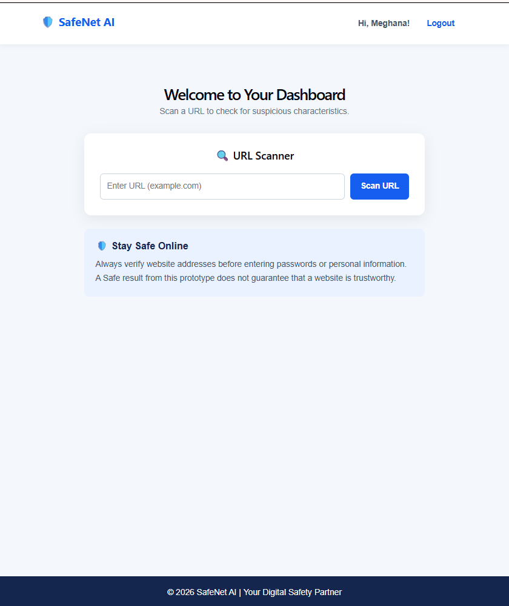

# 🛡️ SafeNet AI

### AI-Based Phishing URL Detection System

SafeNet AI is a web-based security application that analyzes URLs and identifies potentially suspicious or phishing links.

## 🚀 Technologies Used

- React.js
- Python
- FastAPI
- SQLite
- HTML, CSS, JavaScript

## ✨ Features

- User Registration
- Secure User Login
- Phishing URL Scanner
- Suspicious URL Detection
- User Logout

## 📸 Project Screenshots

### Home Page

### Login Page

### Dashboard

### URL Scanner

## ⚙️ How to Run

1. Clone this repository.
2. Start the backend using FastAPI and Uvicorn.
3. Start the frontend using `npm run dev`.
4. Open `http://localhost:5173/` in your browser.

## 👩‍💻 Developed By

**Kukkala Meghana**
