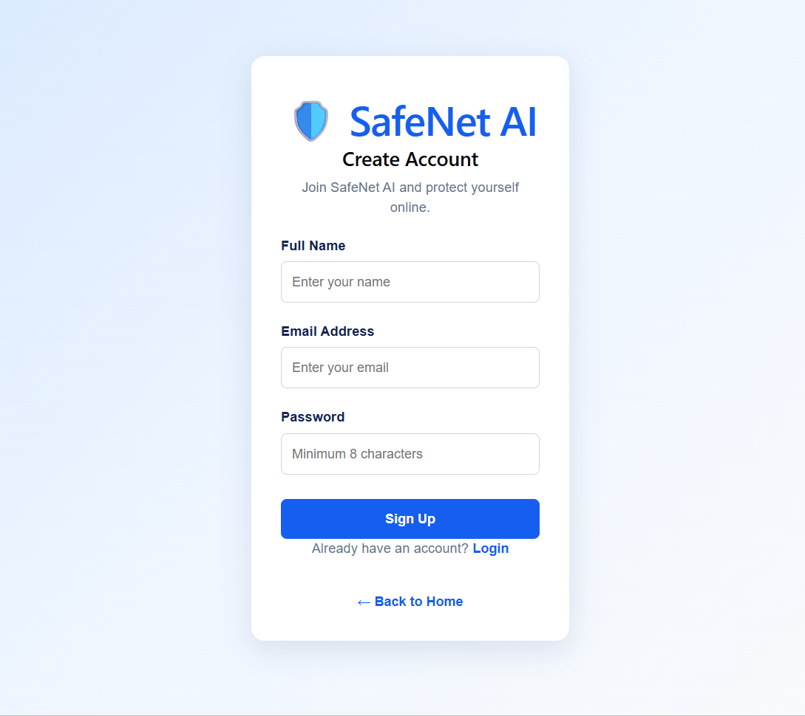
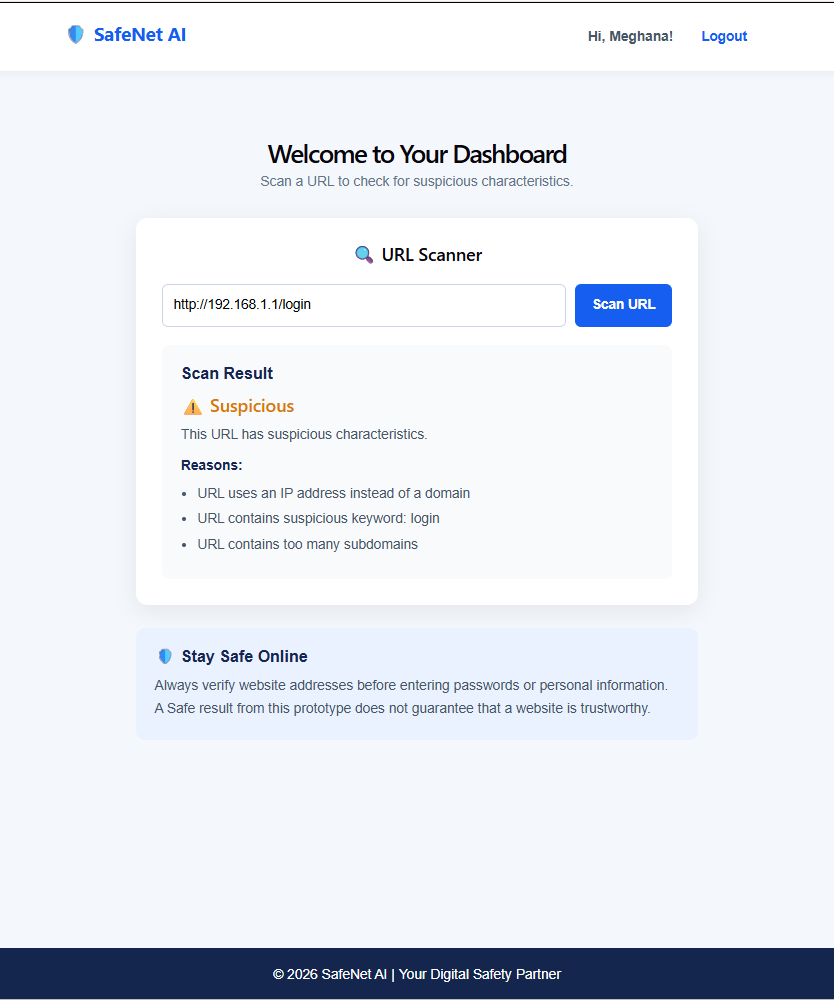

# 🛡️ SafeNet AI

### AI-Based Phishing URL Detection System

SafeNet AI is a web-based security application that analyzes URLs and identifies potentially suspicious or phishing links.

## 🚀 Technologies Used

- React.js
- Python
- FastAPI
- SQLite
- HTML, CSS, JavaScript

## ✨ Features

- User Registration
- Secure User Login
- Phishing URL Scanner
- Suspicious URL Detection
- User Logout

## 📸 Project Screenshots

### Home Page


### Login Page


### Dashboard


### URL Scanner


## ⚙️ How to Run

1. Clone this repository.
2. Start the backend using FastAPI and Uvicorn.
3. Start the frontend using `npm run dev`.
4. Open `http://localhost:5173/` in your browser.

## 👩‍💻 Developed By

**Kukkala Meghana**
## 🏗️ Project Architecture

SafeNet AI follows a client-server architecture.

```text
              USER
                |
                v
        REACT FRONTEND
                |
                v
          FASTAPI BACKEND
                |
          +-----+------+
          |            |
          v            v
    AUTHENTICATION   URL SCANNER
          |            |
          v            v
       SQLITE       SCAN RESULT
       DATABASE
```

### How It Works

1. The user interacts with the React frontend.
2. The frontend sends requests to the FastAPI backend.
3. The backend handles user registration and login.
4. The URL scanner checks submitted URLs using predefined security rules.
5. The results are returned to the frontend and displayed to the user.

## 🔮 Future Enhancements

- Integrate a trained Machine Learning model for phishing detection.
- Add real-time threat intelligence checks.
- Improve URL classification accuracy.
- Deploy the application online.
- Add scan history and reporting.

## 📌 Project Status

The current version is a working prototype with user authentication and rule-based URL scanning.
